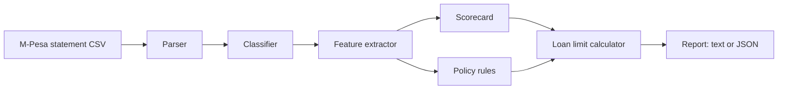

# PesaScore

**Fair credit scores and safe loan limits from M-Pesa statements.**

Millions of Kenyans have no bank credit history, so lenders either turn them away or
price their loans as if they were all high risk. Yet most people's financial lives are
already recorded in their M-Pesa statements: pay arriving, rent going out, Fuliza draws,
betting, digital loans and whether they were repaid.

PesaScore reads that statement and returns:

- a **credit score from 300 to 850**, with a risk band from A to E
- a **loan limit the person can actually afford**, with the monthly payment and term
- the **reasons** behind both, in plain language, so a decline can be explained and
  a borrower knows what to improve

It is written in plain Java 21 with no runtime dependencies, and is covered by unit and
API tests.

```
----------------------------------------------------------------
 PesaScore  655 / 850   Band C (Moderate risk)   Confidence: HIGH
 Statement  2026-01-01 to 2026-06-30, 6 full months, 1988 transactions
----------------------------------------------------------------
 Suggested limit  KES 4,000 over 3 months at 1.5% a month
 Monthly payment  KES 1,374
 Band C allows 60% of a safe instalment over 3 months. Safe instalment: the lower of half of the KES 5,018 left each month and 30% of income.
----------------------------------------------------------------
 Scorecard
  Income level                60 / 70   Typical month brings in KES 41,888
  Income stability           100 / 100  Income moves about 7% from month to month
  Income source               20 / 30   15 repeat sources of income
  Money left after spending   35 / 70   Spends KES 36,870 of a typical month's income
  Savings buffer               0 / 60   Balance covers about 1 day of spending; under KES 100 on 18% of days
  Overdraft (Fuliza) use       0 / 60   18.2 Fuliza draws a month
  Loan repayment              70 / 70   Repaid 100% of KES 3,000 borrowed from 1 lender
  Betting                     50 / 50   Betting equals 0% of income
  Bills and saving            20 / 40   Bills paid in 100% of months; saves 0% of income
 What is holding the score back
  [F5] Balance often runs close to zero
  [F6] Relies on Fuliza to cover everyday spending
  [F4] Spending takes up almost all income
  [F9] Does not set money aside in savings
 What is helping
  [F2] Income arrives steadily every month
  [F7] Pays back what it borrows
  [F1] Healthy monthly income
----------------------------------------------------------------
```
*A boda boda rider: steady daily income, but cash is tight, so the limit is small and short.*

## How it works



1. **Parse.** Reads the statement CSV (`Receipt No., Completion Time, Details, Transaction
   Status, Paid In, Withdrawn, Balance`), skips preamble rows, de-duplicates and reports bad
   lines as warnings instead of failing. Money is held in whole cents, never floating point.
2. **Classify.** Each line's free-text details become one of 20 categories: salary, B2C
   income, transfers, Pay Bill, utilities (KPLC, Nairobi Water), Fuliza draws and repayments,
   digital lenders (Tala, Branch, Zash, Hustler Fund, M-Shwari loans), M-Shwari and KCB M-PESA
   savings, and betting (SportPesa, Betika and others). Phone numbers are masked.
3. **Extract features.** Monthly income and spending (partial first and last months are
   dropped so they don't look like bad months), income stability, the daily closing balance
   and how many days of spending it covers, Fuliza use, loan repayment, betting as a share of
   income, bill regularity and saving.
4. **Score.** A transparent points scorecard. Nine factors with fixed maximums that add up to
   550, so the score is 300 plus the points earned. Every point is traceable, so the factors
   that cost the most points become the reasons.
5. **Apply policy rules.** Some things decline a loan whatever the score: betting at 20% or
   more of income, or owing three or more lenders after repaying less than half.
6. **Size the loan.** The limit comes from affordability, not the score alone. The safe
   instalment is the lower of half the money left each month and 30% of income. It is scaled
   by band (A 100% over 6 months down to D 35% over 1 month, E nothing) and halved for short
   statements. The limit is what that instalment repays at the given interest rate (a standard
   annuity), rounded down to KES 500.

### The scorecard

| Code | Factor | Max | What earns points |
|------|--------|----:|-------------------|
| F1 | Income level | 70 | Higher median monthly income |
| F2 | Income stability | 100 | Low month-to-month variation (coefficient of variation) |
| F3 | Income source | 30 | Regular salary, or several repeat customers |
| F4 | Money left after spending | 70 | A larger share of income left after normal spending |
| F5 | Savings buffer | 60 | Balance covering more days of spending; few days near zero |
| F6 | Overdraft (Fuliza) use | 60 | Few or no Fuliza draws |
| F7 | Loan repayment | 70 | Repaying what was borrowed; minus points for 3+ lenders |
| F8 | Betting | 50 | Little or no betting |
| F9 | Bills and saving | 40 | Bills paid most months; saving part of income |

| Band | Score | Share of safe instalment lent | Term |
|------|-------|------------------------------:|-----:|
| A | 740 to 850 | 100% | 6 months |
| B | 670 to 739 | 80% | 4 months |
| C | 580 to 669 | 60% | 3 months |
| D | 500 to 579 | 35% | 1 month |
| E | 300 to 499 | none | none |

Confidence is **low** under 3 months or 30 transactions, **medium** under 6 months and
**high** otherwise.

## Run it

You need Java 21 and Maven.

```bash
mvn package                                          # builds and runs the tests
java -jar target/pesascore.jar demo rider --out rider.csv   # make a sample statement
java -jar target/pesascore.jar score rider.csv
java -jar target/pesascore.jar score rider.csv --json --rate 0.02
```

### REST API

```bash
java -jar target/pesascore.jar serve --port 8080
curl -X POST --data-binary @rider.csv -H "Content-Type: text/csv" \
     "http://localhost:8080/api/v1/score?rate=0.015"
```

| Method | Path | Body | Returns |
|--------|------|------|---------|
| `POST` | `/api/v1/score` | Statement CSV (max 5 MB); optional `?rate=` monthly interest | Score, offer, reasons, scorecard and features as JSON |
| `GET` | `/health` | | `{"status":"ok"}` |
| `GET` | `/` | | A small page for uploading a statement in the browser |

Errors come back as `{"error": "..."}` with status 400, 405, 413 or 500. The server runs each
request on a virtual thread.

### Docker

```bash
docker build -t pesascore .
docker run -p 8080:8080 pesascore
```

## Sample statements

The built-in generator makes realistic six-month statements for three people. Balances,
Fuliza draws and repayments and transaction charges are worked out line by line. They are
entirely synthetic: the names, numbers and amounts are invented.

| Persona | Who | Score | Outcome |
|---------|-----|------:|---------|
| `salaried` | Teacher with a steady salary, rent, bills and monthly M-Shwari saving | 785 (A) | KES 35,500 over 6 months |
| `rider` | Boda boda rider with many small daily fares, fuel, a bike loan and frequent Fuliza | 655 (C) | KES 4,000 over 3 months |
| `overstretched` | Casual worker with irregular pay, heavy betting, Fuliza and three digital lenders | 430 (E) | Declined by policy rule |

Generate one with `java -jar target/pesascore.jar demo <salaried|rider|overstretched> --months 6 --out file.csv`.

To score a real statement, export it from the M-Pesa app and convert the PDF table to CSV
with the column headers above.

## Project layout

```
src/main/java/ke/pesascore/
  model/      Transaction, Category, Money
  parse/      CSV reader, M-Pesa parser, transaction classifier
  analysis/   Feature extractor and statistics
  scoring/    Scorecard, risk bands, policy rules, loan limit calculator
  report/     Text and JSON reports
  api/        REST server
  demo/       Synthetic statement generator
  Main.java   Command-line interface
```

## Privacy

Statements are processed in memory and are never written to disk or logged. Phone numbers
are masked in everything PesaScore outputs.

## Limits

This is a portfolio project, not a regulated credit bureau. The weights and thresholds are
reasoned from common lending practice, not fitted on real repayment outcomes. The next step
would be to calibrate them against loan performance data, for example with logistic
regression, and to test the score for bias across groups.

## Licence

MIT
